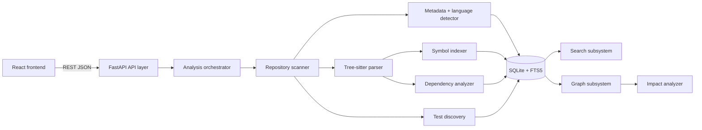

# RepoPilot Architecture

Status: Phase 1 design specification. No application implementation is included.

## 1. Product overview

RepoPilot is a self-hosted, local-first tool for understanding unfamiliar Git
repositories before changing them. It turns a mounted repository into a
searchable file, symbol, and dependency model, then uses reverse dependency
traversal to explain likely change impact. Analysis is deterministic and
inspectable: every result links back to a file, symbol, relationship, or test.

The primary outcome is not a generic file browser or chat experience. It is a
fast answer to: **"If I change this, what else might break?"**

### Goals

- Load a repository from a local path or Docker-mounted workspace.
- Produce useful overview statistics quickly, with visible scan progress.
- Extract files, languages, symbols, imports, dependencies, and tests.
- Support repository-wide filename, symbol, and text search.
- Render a navigable dependency graph without requiring a cloud service.
- Rank direct and transitive change impact, including likely affected tests.
- Keep analysis private, reproducible, and usable on a clean Linux machine.
- Make the 3–5 minute hackathon demo reliable.

### Non-goals for the first implementation

- Full compiler-grade type resolution for every language.
- Runtime tracing, behavioral inference, or semantic equivalence proofs.
- Code mutation, refactoring, or automatic pull requests.
- Cloud accounts, hosted databases, background worker clusters, or queues.
- AI-generated explanations as a dependency of core functionality.
- Mobile-first graph editing or a general-purpose IDE replacement.

## 2. Technology decisions

| Area | Decision | Recommendation | Tradeoff / risk |
|---|---|---|---|
| Frontend | React + TypeScript + Vite | Keep | Fast iteration and strong UI ecosystem. Requires disciplined data-fetching boundaries. |
| Styling | Tailwind CSS + a small shadcn/ui subset | Keep, selectively | Consistent primitives without adopting an entire design system. Utility-heavy markup needs conventions. |
| Graph | React Flow | Keep for the first graph | Excellent interaction primitives and React integration. Very large graphs need server-side filtering and viewport virtualization. |
| Backend | Python 3.12 + FastAPI | Keep | Good parsing/data tooling and typed REST APIs. Async does not make CPU-heavy analysis parallel by itself. |
| Parsing | Tree-sitter with language grammars | Keep, staged | Error-tolerant syntax trees and incremental language adoption. Grammar coverage and version drift need pinning. |
| Storage | SQLite + FTS5 | Keep | Zero external infrastructure, portable artifact, strong local search. Concurrent write throughput is intentionally limited. |
| API | REST + JSON | Keep | Easy browser/Docker integration and debuggability. Graph payloads need explicit limits. |
| Runtime | One container, FastAPI serves built frontend | Keep | Simplest deployment and demo. Separate services can be added later if scale requires it. |
| Tests | Pytest; Vitest + Testing Library; Playwright | Keep | Covers logic, UI behavior, and the hero flow. Browser tests cost more setup than unit tests. |
| Node runtime | Node.js 22 | Keep | Current LTS-era runtime target for Vite tooling. Pin in `.nvmrc`. |
| Python runtime | Python 3.12 | Keep | Stable typing and ecosystem target. Pin in `.python-version`. |

### Alternatives considered

- **Next.js instead of Vite:** rejected for the first version. Server rendering
  adds deployment and routing decisions without helping a local analysis tool.
- **PostgreSQL instead of SQLite:** rejected. External database setup harms
  clean-machine reproducibility and adds no first-demo capability.
- **NetworkX instead of a purpose-built graph model:** rejected as a runtime
  dependency for the core path. A small adjacency index is easier to serialize,
  constrain, and test; specialized graph libraries can be evaluated later.
- **LSP servers instead of Tree-sitter:** deferred. LSP gives deeper semantics
  but adds process management, language-server availability, and nondeterminism.
- **WebSocket scan updates:** deferred. REST polling is sufficient for the
  initial bounded workflow and easier to debug. Server-sent events may follow.
- **Monorepo package manager workspaces:** deferred. Separate frontend/backend
  runtime boundaries are clearer while the repository is still small.

## 3. Logical system architecture



The API owns request validation and response shaping. The analysis orchestrator
owns scan lifecycle and composes pure analysis modules. Persistence is behind a
repository interface so analysis logic can be tested with an in-memory or
temporary SQLite database. The frontend never reads the mounted filesystem;
all repository data passes through the API.

### Information flow

1. User selects a repository path or the configured `/workspace/repo` mount.
2. API validates the path against the allowed root and creates a scan record.
3. Scanner walks files, applies ignore rules, records metadata, and reports
   progress.
4. Detector classifies languages; parser extracts syntax facts for supported
   files; unsupported files remain searchable as text/metadata.
5. Indexers persist symbols, imports, dependencies, tests, and FTS documents in
   one versioned analysis snapshot.
6. Graph and impact queries read the snapshot, apply limits, and return stable
   IDs plus source locations.
7. Frontend renders overview, file, graph, search, and impact views from the
   same snapshot ID.

## 4. Component responsibilities and seams

### Frontend module

**Responsibility:** navigation, query state, presentation, interaction, and
accessibility. **Inputs:** REST DTOs and user actions. **Outputs:** API calls
and route changes. **Failure cases:** stale snapshot, network failure,
oversized graph, inaccessible file. The interface is typed API hooks plus
route-level view models; no parser or graph algorithm lives in the browser.

### API layer

**Responsibility:** REST resources, validation, pagination, error envelopes,
and scan lifecycle authorization. **Inputs:** JSON/query/path parameters.
**Outputs:** versioned JSON DTOs. **Dependencies:** orchestrator and storage
interfaces. **Failure cases:** invalid path, missing snapshot, conflicting scan,
malformed query, analysis unavailable.

### Repository scanner

Walks only an approved repository root, normalizes relative POSIX paths, skips
ignored/generated/binary files, and emits file metadata. It does not parse or
write UI-shaped responses. Failure cases include unreadable files, broken
symlinks, permission changes, and resource limits; each becomes a warning,
not an unexplained global failure, unless the root is inaccessible.

### File metadata analyzer

Calculates size, line estimate, binary flag, extension, path segments, hash,
and modification metadata. It feeds overview statistics and cache checks.

### Language detector

Uses extension first, then a bounded content probe for extensionless files.
Returns a canonical language ID, confidence, and detection method. Unknown is
a valid result. Generated/vendor paths are marked separately from language.

### Parser

Runs the selected Tree-sitter grammar with bounded input. Emits syntax facts
and source ranges; parser errors are retained as diagnostics. Unsupported
languages use a no-parser path and remain available to text search.

### Symbol indexer

Maps parser facts into stable symbols: module, class, function, method, and
selected exported/constants. Stores qualified name, kind, range, parent, and
file. It must tolerate duplicate names and partial trees.

### Dependency analyzer

Resolves imports/includes/references to repository files or symbols when
possible. It records the original import text, relationship type, resolution
status, and external package name. It never silently turns an unresolved edge
into a resolved one.

### Search/index subsystem

Maintains normalized FTS5 documents for paths, symbols, imports, and source
text. Search returns typed hits with snippets and source ranges. Index writes
belong to a scan transaction/snapshot; queries never see a half-built snapshot.

### Graph subsystem

Projects persisted dependencies into bounded graph DTOs. It supports forward,
reverse, neighborhood, depth, grouping, and relationship filters. It is a
query layer, not a second source of truth.

### Impact analysis engine

Starts at a file or symbol, traverses reverse repository dependencies, ranks
results by distance and relationship confidence, and joins test discovery.
It returns evidence for each result, not just a list of filenames.

### Test discovery

Detects conventional test paths and names (`test`, `tests`, `spec`, `.test`,
`.spec`) plus parsed test symbols where available. It links tests directly or
through affected modules and reports heuristic confidence.

### Persistence layer

Owns SQLite connection setup, schema migrations, snapshot visibility, FTS
maintenance, and query repositories. WAL mode is appropriate for read-heavy
local use; one writer at a time remains the explicit operating model.

### Docker/runtime layer

Builds frontend assets in a Node build stage, installs Python runtime
dependencies in a slim Python stage, copies static assets, and starts one
FastAPI process serving API and frontend fallback. Repository and optional data
directories are mounted explicitly.

## 5. Internal data model

All records carry `snapshot_id` and stable local IDs. Paths are repository-
relative POSIX strings; source ranges use zero-based lines/columns internally
and one-based display coordinates at the API boundary.

| Entity | Important fields | Relationships |
|---|---|---|
| Repository | `id`, `display_name`, `root_label`, `source_kind`, `created_at` | Has snapshots and settings |
| AnalysisSnapshot | `id`, `repository_id`, `status`, `tool_version`, `started_at`, `finished_at`, `warnings` | Owns all analysis records |
| Directory | `id`, `path`, `name`, `parent_id` | Contains files/directories |
| File | `id`, `path`, `name`, `directory_id`, `language_id`, `size`, `sha256`, `is_generated`, `is_binary` | Has symbols, imports, dependencies, tests |
| Language | `id`, `name`, `extensions`, `color_key` | Referenced by files |
| Module | `id`, `file_id`, `qualified_name`, `kind` | Contains symbols; graph anchor |
| Symbol | `id`, `file_id`, `parent_id`, `name`, `qualified_name`, `kind`, `start`, `end`, `exported` | Defines/imports relationships |
| Import | `id`, `file_id`, `raw_text`, `target_text`, `line`, `resolution_status` | Produces dependency edge |
| Dependency | `id`, `source_file_id`, `target_file_id`, `target_symbol_id`, `kind`, `confidence`, `is_external` | Directed graph edge |
| Test | `id`, `file_id`, `symbol_id`, `framework_hint`, `name`, `confidence` | Linked to files/symbols |
| Graph node | `id`, `entity_type`, `entity_id`, `label`, `path`, `group`, `metrics` | API projection of file/module/symbol |
| Graph edge | `id`, `source`, `target`, `kind`, `confidence`, `evidence` | API projection of dependency |
| Analysis result | `id`, `snapshot_id`, `kind`, `status`, `warnings`, `duration_ms` | Scan/graph/search operation record |
| Impact result | `id`, `root_entity_id`, `affected_entity_id`, `distance`, `category`, `confidence`, `evidence` | Belongs to impact request |

Use normalized relational tables for authoritative data. Use FTS5 as a derived
index. Keep graph nodes/edges as response projections to avoid duplicated
mutable truth.

## 6. Dependency graph

### Semantics

- A file node is the default graph node; a module or symbol node is opt-in for
  detailed views.
- A directed edge points from importer/consumer to imported/depended-on target.
- Edge kinds include `import`, `include`, `call`, `inheritance`, `type`, and
  `test_reference`; first implementation prioritizes `import` and
  `test_reference`.
- Reverse dependencies are computed by traversing incoming edges; no duplicate
  reverse graph needs storage.
- Unresolved imports become explicit `unresolved:<normalized-name>` external
  nodes only when the query requests them. Default views show an unresolved
  count badge instead.
- External packages become grouped external nodes with package name and edge
  count, not thousands of repeated package edges.
- Cycles remain in the graph. Traversal uses a visited set and reports cycle
  membership in relationship details.

### Fictional example

Repository files: `src/auth/AuthService.ts`, `src/auth/AuthController.ts`,
`src/session/SessionManager.ts`, `src/ui/LoginPage.tsx`, and
`tests/auth.test.ts`.

```json
{
  "nodes": [
    {"id":"f:auth-service","type":"file","label":"AuthService.ts"},
    {"id":"f:auth-controller","type":"file","label":"AuthController.ts"},
    {"id":"f:session","type":"file","label":"SessionManager.ts"},
    {"id":"f:login","type":"file","label":"LoginPage.tsx"},
    {"id":"f:auth-test","type":"file","label":"auth.test.ts"}
  ],
  "edges": [
    {"source":"f:auth-controller","target":"f:auth-service","kind":"import","confidence":1.0},
    {"source":"f:session","target":"f:auth-service","kind":"import","confidence":1.0},
    {"source":"f:login","target":"f:auth-controller","kind":"import","confidence":0.9},
    {"source":"f:auth-test","target":"f:auth-service","kind":"test_reference","confidence":0.8}
  ]
}
```

Graph traversal supports `direction=outgoing|incoming|both`, `depth`, edge
kind filters, language/path filters, and a hard node/edge limit. The API returns
`truncated=true` plus expansion hints when a limit is reached.

## 7. Impact analysis

### Practical first algorithm

1. Resolve the changed file or symbol to a snapshot entity.
2. Add incoming repository dependency edges to a priority queue.
3. Traverse reverse edges up to a configurable depth (default 3), with a
   visited set and per-edge confidence.
4. Score each result from directness, shortest distance, edge confidence,
   symbol specificity, and test/path heuristics.
5. Categorize results as direct files, affected modules, likely tests,
   external/unresolved references, or low-confidence candidates.
6. Return evidence: path, relationship chain, line/range, edge kinds, and
   confidence label (`high`, `medium`, `low`).

### Example: `src/auth/AuthService.ts`

`AuthController.ts` and `SessionManager.ts` import the changed file: direct,
high-confidence results. `LoginPage.tsx` imports `AuthController.ts`: distance
2, medium confidence. `UserService.ts` reaches it through `SessionManager.ts`:
distance 2, medium confidence. `auth.test.ts` directly references the service:
test, high confidence. `session.test.ts` references `SessionManager.ts`:
distance 2, likely test. The result groups these into **Direct dependents**,
**Transitive dependents**, and **Potentially affected tests**, each expandable
to its chain.

### Limits and correctness

- Default depth 3 avoids turning an ordinary edit into the whole repository.
- Cycles terminate through visited IDs; the UI flags cycle participation.
- External/unresolved dependencies are evidence, not proof of impact.
- False positives are expected from broad imports, barrel files, dynamic
  imports, reflection, and convention-based tests.
- False negatives can result from generated code, runtime loading, aliases
  without configuration, unsupported grammars, and string-based references.
- The UI must say “potentially affected,” never “will break.”

## 8. Search design

Create one FTS5 document per searchable unit with fields for `path`, `name`,
`qualified_name`, `kind`, `language`, `content`, and `snapshot_id`. Store line
and symbol metadata in ordinary tables keyed by document ID.

- Path/filename search: prefix and token matching, path boost.
- Exact symbol lookup: normalized qualified name, then exact name.
- Symbol/function/class search: kind and language filters, name boost.
- Import search: raw and normalized target fields.
- Text/code search: FTS5 token matching with snippets and source ranges.
- Case-insensitive by default; exact case can be requested.
- Partial matches use prefix tokens; avoid substring scans over full source by
  default. A bounded literal fallback is allowed for short queries.
- Sort by exactness, kind, path proximity, symbol priority, then path.
- Limit results and paginate. Large files can store chunked content documents.

Search index writes occur after metadata and parse records are ready, then the
snapshot is atomically marked queryable. A failed scan cannot replace the last
successful snapshot.

## 9. API and UI architecture

The API surface is defined in [`api-design.md`](api-design.md). The screen,
navigation, component, and interaction design is defined in
[`ui-design.md`](ui-design.md). Frontend routes are URL-addressable and carry
`repositoryId`, `snapshotId`, and relevant entity/query parameters.

State approach: server state uses a small query/cache layer (TanStack Query is
recommended if dependency budget permits); local view state uses React state
and URL search parameters. Do not introduce a global store until cross-route
state proves necessary. API DTOs are generated or hand-maintained in one typed
client module; views consume hooks, not raw `fetch`.

Loading states are skeleton rows/panels plus scan progress. Empty states explain
the next action. Errors preserve the last useful data and expose retry/details.
Keyboard shortcuts and responsive behavior are specified in `ui-design.md`.

## 10. Docker architecture

Use a multi-stage image:

1. Node 22 builder installs the locked frontend dependencies and builds static
   assets.
2. Python 3.12 runtime installs locked backend dependencies into the image,
   copies backend code and built assets, and runs FastAPI/Uvicorn.
3. FastAPI serves `/api/*` and static frontend assets, with SPA fallback for
   known UI routes.

Target command:

```bash
docker build -t repopilot .
docker run --rm -p 3000:3000 \
  -v "$(pwd)/sample-repo:/workspace/repo:ro" \
  repopilot
```

Environment variables configure `REPOPILOT_REPOSITORY_ROOT`, data directory,
host/port, scan limits, and log level. Defaults must be container-safe and
must not contain developer-machine paths. Optional persistent data uses a
named volume or explicit mount; the source repository is read-only by default.

Run as a non-root user, reject paths outside the allowed root, do not follow
symlinks outside it, cap file size/count/scan duration, skip binaries and
secrets from content indexing where practical, and avoid exposing raw source
outside authenticated/local deployment assumptions. A hostile repository can
consume CPU or disk; bounded queues, timeouts, quotas, and cancellation are
required before claiming production hardening.

## 11. Performance targets

| Repository | First useful result | Strategy |
|---|---:|---|
| 1,000 files | seconds | Full metadata/parse/index; eager overview. |
| 10,000 files | under a minute target | Ignore vendor/build output, stream progress, cache unchanged hashes, lazy deep graph. |
| 50,000+ files | bounded and cancellable | Strict limits, metadata-first overview, selective parsing, paged search, neighborhood graph only. |

Ignore `.git`, dependency/vendor directories, build output, generated files,
large media/binary files, and configured patterns. Cache by repository-relative
path plus content hash, parser/tool version, and configuration version.
Compute overview eagerly; parse deep symbols, full content snippets, and wide
graphs lazily. Browser graph queries default to one neighborhood and a hard
node limit; aggregate by directory/module before rendering large views.

## 12. Security and privacy

- Canonicalize and validate every path against the configured repository root.
- Use relative paths in API responses; never accept arbitrary filesystem paths
  from a browser query.
- Reject or label symlinks that escape the root; avoid following them by default.
- Treat repository files as untrusted data; never execute hooks, package scripts,
  build commands, or language runtimes during analysis.
- Detect binary/oversized files before reading full content.
- Keep source data local; redact secret-like content from logs and diagnostics.
- Limit scan workers, open files, memory, SQLite growth, and request duration.
- Escape source snippets in the frontend; graph labels are data, not markup.
- Use read-only repository mounts and a non-root container user.

## 13. Testing strategy

Backend unit tests cover scanner ignore/path rules, language detection, parser
fixtures, symbol extraction, dependency resolution, graph traversal, impact
ranking, FTS queries, and test discovery. Integration tests cover scan lifecycle,
snapshot replacement, endpoint DTOs, and the complete analysis workflow.

Frontend tests cover navigation, loading/error/empty states, search keyboard
behavior, file selection, graph filtering/selection, and impact grouping. One
Playwright test loads the deterministic sample repository, waits for scan
completion, opens the graph, runs impact analysis, and navigates to an affected
file.

The sample repository should contain a small TypeScript app with `AuthService`,
`AuthController`, `SessionManager`, `LoginPage`, `UserRepository`, direct and
transitive tests, one unresolved import, and a deliberate cycle. It must be
small, deterministic, and committed as fixture source only when implementation
starts.

## 14. Hackathon demo flow

1. Import or mount a known sample repository.
2. Show scan progress, then overview counts and language mix.
3. Open the graph and show grouped architecture with one selected file.
4. Search `AuthService` and jump to its definition.
5. Run impact analysis for `src/auth/AuthService.ts`.
6. Expand direct dependents, transitive modules, and affected tests.
7. Open one affected file from its evidence chain.

Minimum reliable demo: repository load, metadata scan, file tree, symbol/text
search, bounded dependency graph, reverse impact traversal, test grouping, and
deep links. Defer multi-language semantic precision, live Git diffs, code
editing, collaboration, AI explanations, and unrestricted graph rendering.

## 15. Implementation phases

### Phase 2 — Project/toolchain foundation

Deliver pinned Node/Python versions, locked dependencies, frontend/backend
shells, FastAPI health endpoint, Vite shell, shared DTO conventions, Docker
build target, and offline test command. Acceptance: clean Linux build and
empty app starts in one container.

### Phase 3 — Scanner and file tree

Implement approved-root validation, ignore rules, metadata, language detection,
scan lifecycle, progress, SQLite schema, and file-tree endpoint/UI. Tests:
scanner fixtures, path/security cases, scan integration.

### Phase 4 — Parsing, symbols, dependencies

Add Tree-sitter grammars, symbol extraction, import resolution, dependency
records, diagnostics, and file detail endpoint. Tests: parser fixtures,
resolution cases, unresolved/cycle cases.

### Phase 5 — Search/indexing

Add FTS5 schema, atomic indexing, ranked query endpoint, snippets, and search
screen. Tests: exact/prefix/case/path/symbol/text queries and rebuild behavior.

### Phase 6 — Dependency graph

Add bounded graph query projections, filters, grouping, React Flow view,
selection, minimap, and deep links. Tests: graph DTO limits, cycles, UI
selection/filter behavior.

### Phase 7 — Impact analysis

Add reverse traversal, depth/confidence scoring, test joins, impact endpoint,
and impact screen. Tests: direct/transitive ranking, cycles, unresolved edges,
test categorization, and the hero fixture.

### Phase 8 — UI polish and integration

Complete overview, hotspots, tests, notifications, command palette, keyboard
shortcuts, responsive layouts, accessibility, and error recovery. Tests: route
flows, keyboard paths, reduced motion, and critical component behavior.

### Phase 9 — Testing, Docker, clean-machine verification

Add end-to-end smoke test, locked builds, non-root image, mount documentation,
resource limits, reproducibility check, and concise runbook. Acceptance: the
documented Docker commands work on a clean Linux host without cloud services.

## 16. Risks and mitigations

- **Parser coverage:** start with TypeScript/JavaScript/Python; expose unknown
  and partial results rather than blocking the scan.
- **Graph overload:** default to neighborhoods, aggregation, and hard limits.
- **Impact trust:** show relationship evidence and confidence; use “potentially.”
- **Scan time:** metadata-first progress, hashes, cache, cancellation.
- **SQLite writes:** one orchestrated writer and snapshot swaps; defer parallel
  writer architecture until measured.
- **Docker size/build drift:** pin versions, multi-stage image, lockfiles, and
  clean-machine CI before the demo.
- **Security assumptions:** read-only mounts, no code execution, root checks,
  quotas, and explicit deployment warning for unauthenticated local mode.

## 17. Future extensions

Git diff-aware impact analysis, more language grammars, configuration-aware
alias resolution, LSP adapters, incremental rescans, saved architecture views,
exportable reports, team permissions, optional authentication, and an optional
AI explanation layer can follow once deterministic core analysis is reliable.

## Phase 3G test relationship intelligence

Test relationships are derived from READY snapshot files and dependencies. Direct internal test imports are strong evidence; deterministic filename/path matches are heuristic associations. This phase does not execute tests or calculate runtime coverage.

## Phase 4B repository overview

Dashboard values are selected-repository READY-snapshot aggregates. No mock KPI values are used.

## Phase 4C file hub

The file hub bridges source content, symbols, dependencies, tests, hotspots, impact, graph, and search using existing APIs. It is a viewer, not an editor or test runner.
